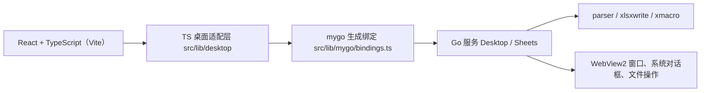

# MyGo 重构方案

制定日期 2026-11-28。迁移基线为 StructSheet 0.2.0（Rust + GPUI 实现），参照
[tcreader 的 MyGo 重构方案](../../tcreader/docs/dev/mygo-refactoring-plan.md)
实施。目标是把桌面壳与业务后端从 Rust/GPUI 迁到 **MyGo Web（Go）**，前端改为
React + TypeScript + Vite，Windows 继续使用系统 WebView2。

## 1. 目标与范围

- 桌面壳由 GPUI（Rust）改为 **MyGo**（Go，WebView2 承载页面）。
- 业务后端由 Rust 移植到 Go：结构体解析（parser）、Excel 导出（excel）、表格转
  X-Macro（table_xmacro）。
- 前端沿用 React/TypeScript/Vite 生态，UI 布局参照 tcreader（隐藏原生标题栏、
  页面自绘标题栏 + `--app-region: drag`、顶栏工具栏、左右分栏面板、模态工具框、
  右下角通知）。
- 行为等价是交付标准：解析结果（字段行、偏移、大小、分组底色、表头、冻结与
  自动筛选）与 Rust 版逐字段一致，差异以 gold 对照与单测锁定。
- 迁移完成后移除 `src-gpui/`（Rust 实现），MyGo 版为唯一入口。

## 2. 目标架构



| 边界 | 设计 |
| --- | --- |
| React ↔ 桌面 API | `src/lib/desktop/` 收口窗口控制、系统对话框、文件打开/定位、版本号；生产走 MyGo 绑定，浏览器/测试注入 mock（`setDesktopForTests` / `setSheetsForTests`）。 |
| MyGo ↔ Go | 绑定层只暴露业务方法与桌面动作；用 `mygo generate` 生成 `src/lib/mygo/bindings.ts`。Go 侧返回 DTO，字段为 camelCase（如 `parameterName`）。 |
| Go ↔ 业务数据 | 解析与导出全部在本机内存完成，不落盘用户数据；页面传源码文本，Go 回字段行或写 xlsx。 |
| 构建与启动 | Bun 管理前端依赖与构建，`go tool mygo dev/build` 负责桌面壳；`bun.lock` 固定前端依赖，`go.sum` 固定 Go 依赖。 |

### 2.1 窗口与权限

- 主窗口隐藏原生标题栏（`TitleBarStyle: mygo.TitleBarHidden`），`HideWindowButtons`，
  页面用 `--app-region: drag` 自绘标题栏并接管最小化/最大化/关闭。
- 页面设置权限处理器一律拒绝；`SetWindowOpenHandler` 拒绝弹窗；`OnWillNavigate`
  仅允许应用自身页面与开发服务器（`127.0.0.1`/`localhost`），其余拦截。
- 单实例锁 + 二次启动聚焦主窗口。

## 3. 实施阶段

| 阶段 | 实施内容 | 完成条件 |
| --- | --- | --- |
| 0 基线与对照 | 固定 Rust 对照提交，记录解析输出与导出工作簿结构。 | 关键流程有可复现输入与预期结果。 |
| 1 工具链 | 引入 `bun` + `bun.lock`，Vite 7 / TypeScript 5.8 / Vitest；`go.mod` 锁定 mygo 0.10.0。 | 冻结安装、`tsc`、`vite build` 与单测在 Windows 可运行。 |
| 2 MyGo 壳与适配层 | 隐藏标题栏窗口、`src/lib/desktop` 适配层、生成绑定、浏览器 mock。 | 窗口可显示页面，桌面按钮与对话框驱动正常，测试可注入 mock。 |
| 3 Go 只读业务（解析） | 移植 `parser.rs`：分词、预处理条件块、宏展开与常量求值、结构体收集、字段声明、布局（对齐/`#pragma pack`/位字段/union/嵌套展开）。 | Rust 单测全部移植为 Go 单测并通过，字段行逐字段对齐。 |
| 4 Go 导出 | 移植 `excel.rs`：纯 Go（`archive/zip`+`encoding/xml`）生成带黄色表头、分组底色、边框、列宽、冻结首行、自动筛选的工作簿。 | 生成产物可被自身读取器与 Excel/WPS 正确打开。 |
| 5 表格转 X-Macro | 移植 `table_xmacro.rs`：xlsx/csv/剪贴板表格识别与 `X(type,name,offset,size)` 代码生成。 | CSV/XLSX/剪贴板用例通过。 |
| 6 前端 UI | React 迁移原 Web 视觉（暖纸底、黄色主按钮、等宽预览表），布局参照 tcreader。 | 解析、预览、导出、X-Macro 全流程可用。 |
| 7 打包与验证 | `go tool mygo build -skip-installer` 产出 exe；真实窗口启动、日志与构建产物体积核验。 | exe 启动加载真实 UI，无 panic，体积在合理范围。 |

## 4. 命令与工具链

```bash
# 安装依赖（Windows，无需系统 node/pnpm）
bun install --frozen-lockfile

# 开发（MyGo 壳 + Vite 热更新 + WebView2 窗口）
bun run dev:mygo

# 前端类型检查与单测
bun run check:static      # tsc --noEmit + go vet
bun run test:unit

# Go 后端测试
cd src-mygo && go test ./...

# 生产构建（前端 + Go 壳，嵌入 dist）
cd src-mygo && go tool mygo build -skip-installer
```

## 5. 旧实现 → MyGo 命令映射

| 旧（Tauri/GPUI） | MyGo 绑定（`src/lib/mygo/bindings.ts`） |
| --- | --- |
| `parse_source(source, root_name)` | `Sheets.parseSource(source, rootName)` |
| `list_structs(source)` | `Sheets.listStructs(source)` |
| `export_excel(source, root_name, path)` | `Sheets.exportExcel(source, rootName, path)` |
| `convert_table_to_xmacro(path, clipboard, macro, struct)` | `Sheets.convertTableToXMacro(...)` |
| `save_text_file(path, content)` | `Sheets.saveTextFile(path, content)` |
| 文件选择器 / 保存对话框 | `Desktop.pickFiles` / `Desktop.saveFile` |
| 复制到剪贴板 | `navigator.clipboard`（渲染层） |
| 导入头文件读取 | `Sheets.readTextFile(path)` |

## 6. 测试与验证

- Go 后端：`parser`（嵌套/指针/联合/位字段/`#pragma pack`/条件宏/函数宏/多行宏/
  未知类型告警）、`xlsxwrite`（有效容器、生成→回读闭环、XML 转义、样式与冻结/
  筛选）、`xmacro`（字节区间、CSV、XLSX、剪贴板、标识符规范、中文表头、空输入）。
- 前端：`src/App.test.tsx` 覆盖品牌与版本、解析预览、解析错误、导出、X-Macro
  对话转换。
- 构建：`tsc --noEmit`、`vite build`、`go tool mygo vet`、`go tool mygo build`
  均通过；`dist/windows-arm64/StructSheet.exe` 启动加载真实 UI（应用日志记录启动
  成功，无 panic）。

## 7. 已知差异与后续

- 表格输入格式：Go 版支持 `.xlsx`、`.csv` 与剪贴板粘贴；`.xls/.xlsb/.ods`
  返回明确的中文错误提示，建议另存为 `.xlsx`/`.csv`（`calamine` 的原生多格式
  支持未移植，按需再补纯 Go 读取器）。
- `src-gpui/`（Rust/GPUI）已按 tcreader 收尾流程移除，MyGo 版为唯一入口。
